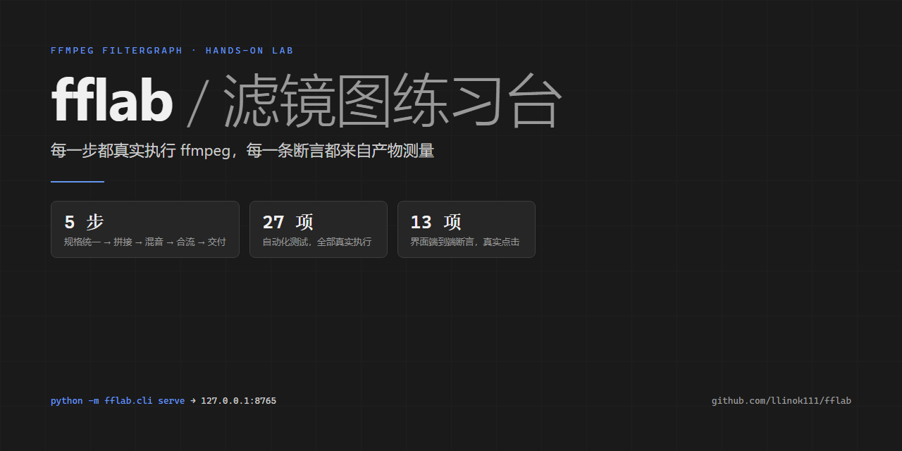
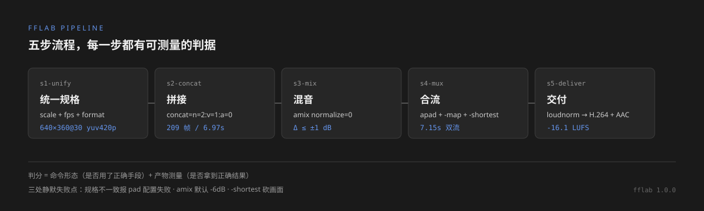
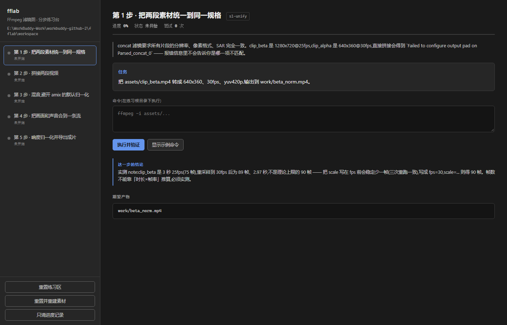
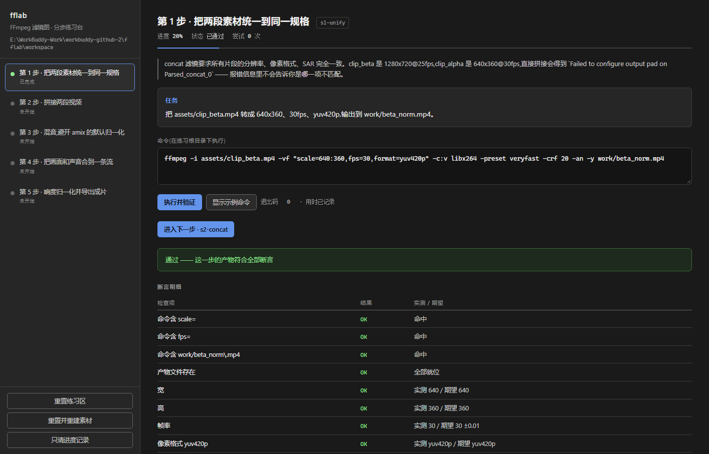
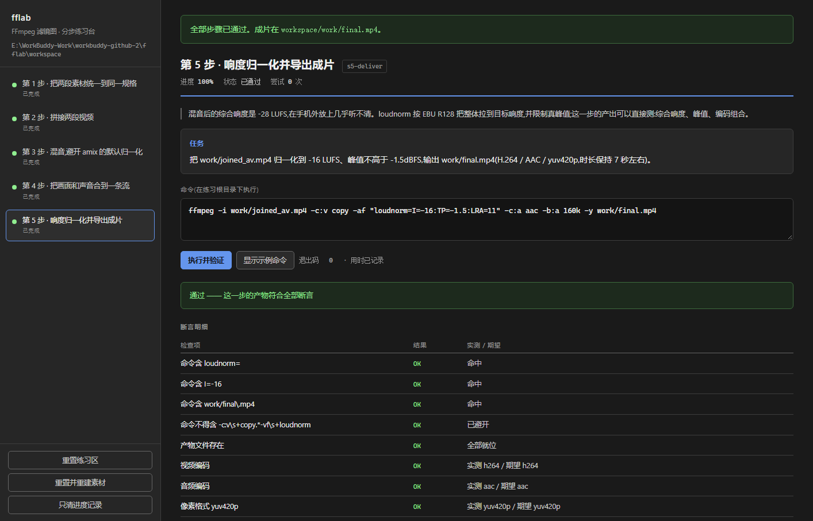
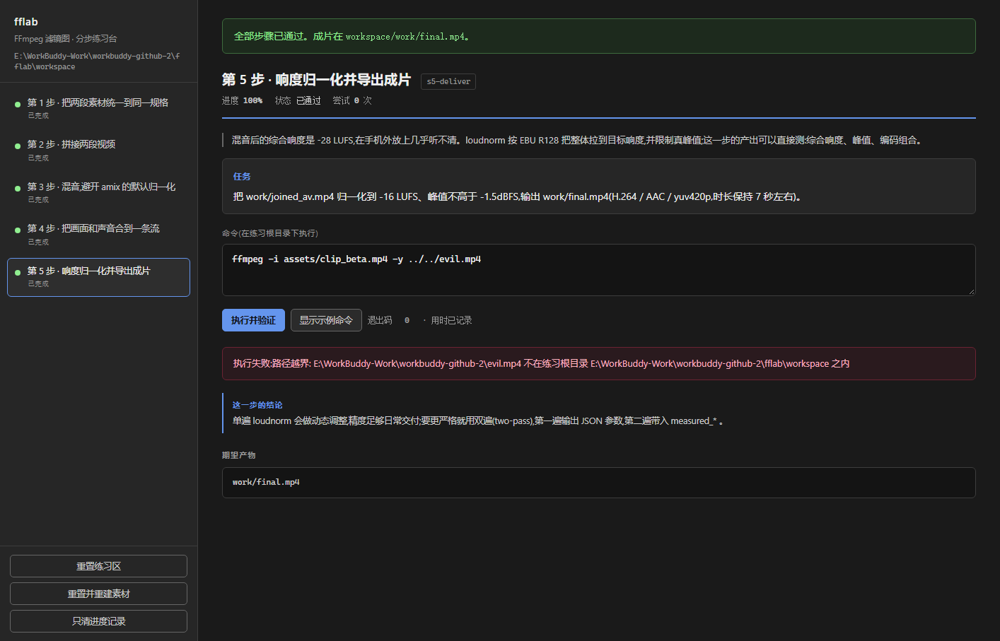

# fflab · FFmpeg 滤镜图交互式练习台



面向 FFmpeg `filter_complex` 的**可验证**分步教程。每一条断言都由真实 `ffmpeg` 执行后的测量值支撑，不靠"看起来对了"。

- 上游工具：[FFmpeg](https://github.com/FFmpeg/FFmpeg)（★ 65.6k）
- 教学主题：从两段规格不同的素材，走到一条可交付的成片
- 五步流程，全程真实执行、真实测量、真实断言
- 练习区与真实数据隔离，可一键重置

---

## 1. 为什么选 FFmpeg

| 判据 | 事实 |
| --- | --- |
| 学习门槛 | `filter_complex`、`-map`、PTS/时间基、流选择是最容易静默出错的部分；错误信息往往只说"configure output pad failed"，不说是哪一项参数不匹配 |
| 核心功能真实可用 | 本机 `ffmpeg 7.1`（gyan.dev essentials build）已实测可调用；本文档所有数字都来自该构建的实际输出 |
| 是否值得做成教程 | 它的失败是**可测量**的（帧数、时长、响度、编码组合），因此可以自动判分，而不是让学员自己猜 |

---

## 2. 快速开始

环境要求：Python 3.9+、`ffmpeg` 在 PATH 中（**不要求 ffprobe**，见 §6.1）。

```bash
cd fflab

# 方式一:命令行
python -m fflab.cli init          # 建立练习区并合成素材
python -m fflab.cli status        # 查看进度
python -m fflab.cli run s1-unify --hint   # 用示例命令跑第 1 步
python -m fflab.cli demo          # 自动跑完整流程(自检)
python -m fflab.cli reset --all   # 重置并重建素材

# 方式二:交互界面
python -m fflab.cli serve         # 打开 http://127.0.0.1:8765/
```

Windows 用户可直接双击 `start.cmd`（界面）或 `test.cmd`（自测）。

---

## 3. 五步教学流程



| 步骤 | 做什么 | 核心陷阱 | 断言依据 |
| --- | --- | --- | --- |
| `s1-unify` | 把 1280x720@25fps 统一成 640x360@30fps/yuv420p | 不统一规格，下一步 concat 直接报 `Failed to configure output pad` | 宽/高/帧率/像素格式四项实测 |
| `s2-concat` | 拼接两段视频（只保留画面） | 以为"4s+3s=7s、210 帧"；实测是 **209 帧 / 6.97s** | 时长 6.9–7.1s、帧数 208–212 |
| `s3-mix` | 旁白 + 背景乐混音 | `amix` 默认 `normalize=1`，主轨**掉 6dB**，日志无任何警告 | 混音后相对旁白电平变化 ∈ [-1, +1] dB |
| `s4-mux` | 画面 + 声音合成一条流 | 少写 `apad` 又用 `-shortest`，成片被截成 4 秒，画面后 3 秒全丢 | 含视频流/含音频流/时长 6.8–7.2s |
| `s5-deliver` | 响度归一化并导出 | 混音后 -28 LUFS，手机外放几乎听不清 | LUFS ∈ [-17,-15]、峰值 ≤ -1.5dB、H.264+AAC+yuv420p |

每一步的判分是**两条独立证据**：命令形态（`must_match` / `must_not_match` 正则）+ 产物实测（`probe` / `volumedetect` / `ebur128`）。只满足其一的答案不算通过。

---

## 4. 隔离与重置

| 机制 | 实现 | 验证方式 |
| --- | --- | --- |
| 目录隔离 | 全部读写限制在 `workspace/` 内；`Sandbox.resolve()` 展开 `..` 与符号链接后再比对 | `test_path_guard_relative_escape` / `_absolute_escape` |
| 越界写入 | `-y ../../evil.mp4`、`C:/Windows/Temp/evil.mp4` 均被拒 | `test_run_rejects_escape_path`（HTTP 403） |
| 素材只读 | `assets/` 不可作为输出目标；执行前后复核 sha256 | `test_guard_rejects_overwrite_asset` / `test_asset_fingerprint_detects_tamper` |
| 协议绕过 | `https://`、`concat:`、`movie=` 等一律拒绝 | `test_guard_rejects_protocol_input` / `_movie_filter_outside` |
| shell 注入 | 拒绝 `;` `&&` `\|\|` `\|` `>` `<` 反引号 `$(`；不经 shell 执行 | `test_shell_metacharacters_rejected` / `_no_shell_escape_on_stdin_pipe` |
| 重置 | `scope=work` 只清产物；`scope=all` 连素材一起重建；可只清进度 | `test_reset_work_keeps_assets` / `test_reset_all_rebuilds_assets` |
| 幂等 | 重复 `init` 不重建已有素材，指纹不变 | `test_init_is_idempotent` |

**不会碰你的真实文件**：默认根目录是 `./workspace`，且所有路径在解析后必须落在其内。

---

## 5. 验证结果

### 5.1 自动化测试（真实执行，无 mock）

```
python -m unittest discover -s tests
Ran 27 tests in 18.0s
OK
```

分四组：沙箱守卫 10 项、测量原语 4 项、教程正/反例 9 项、HTTP 服务 5 项。

**反例必须被拒**（否则判分器等于没有）：

| 错误做法 | 被哪条断言抓住 | 实测 |
| --- | --- | --- |
| 不缩放直接交付 | 宽/高/帧率 | 1280x720@25 而非 640x360@30 |
| `amix` 不加 `normalize=0` | 电平变化 | **-5.9 dB** |
| 少写 `apad` 却用 `-shortest` | 时长 | **4.0s** 而非 7s |

### 5.2 界面端到端（CDP 真实点击）

```
node tools/ui-e2e.mjs --port 8765 --shots ./shots
合计 13 项,失败 0 项
```

覆盖：侧栏 5 步渲染、主区标题、文本块无重叠（重叠对数 0）、无横向溢出、逐步点击执行 5 次全部通过、完成横幅、进度 100%、越界命令被界面拦下、重置后进度归零。

界面实拍（均为脚本自动截取，非手工拼图）：

| 待开始 | 断言通过 |
| --- | --- |
|  |  |

| 全流程完成 | 越界命令被拦 |
| --- | --- |
|  |  |

### 5.3 截图像素统计（本机读图链不可用，改用可复算数值）

```
python tools/png_stats.py shots/*.png
OK   01-step1-idle.png        1414x907  色数=2330  亮度=32.69  分带σ=4.74
OK   02-step1-passed.png      1414x907  色数=2806  亮度=34.82  分带σ=3.47
OK   03-all-completed.png     1414x907  色数=2463  亮度=35.3   分带σ=3.12
OK   04-escape-rejected.png   1414x907  色数=2516  亮度=34.04  分带σ=4.12
```

统计器自身也做了反例校验：纯黑/纯白/单色图均被判 FAIL（色数=1、分带σ=0），证明阈值真的能抓住空帧。

---

## 6. 关键实现说明

### 6.1 为什么不用 ffprobe

本机 PATH 里只有 `ffmpeg.exe`，**没有 `ffprobe.exe`**。因此所有探测改为：

- 元数据：`ffmpeg -i <file> -f null -` 的输入转储解析
- 帧数：`-progress pipe:1` 的结构化 `key=value`（比解析人类可读日志稳定）
- 响度：`ebur128=framelog=quiet` + `volumedetect`

好处是少一个依赖；代价是解析逻辑必须自己维护（`_VIDEO_RE` / `_PIXFMT_RE` 等）。

**像素格式的解析坑**：它位于 codec 名之后、分辨率之前
（`Video: h264 (High) (avc1 / ...), yuv420p(progressive), 640x360`）。
按"分辨率位置反查"会抓到码率数字（实测得到 `954`、`3328`），必须按逗号切分取第 2 段。

### 6.2 帧数不能靠"时长×帧率"推算

`clip_beta` 是 3 秒 25fps（75 帧）。重采样到 30fps：

| 滤镜写法 | 输出帧数 | 时长 |
| --- | --- | --- |
| `fps=30` | 90 | 3.00s |
| `fps=30,scale=640:360` | 90 | 3.00s |
| `scale=640:360,fps=30` | **89** | **2.97s** |

三次重跑结果完全一致（确定性偏差，非随机）。`fps` 滤镜自己的日志会显示
`75 frames in, 89 frames out; 1 frames dropped, 15 frames duplicated`。

本教程的示例命令采用 `scale=...,fps=30`，因此断言按 89 帧 / 209 帧设计。
**这一条只陈述实测结果与日志证据，不对底层成因下结论** —— 未做源码级验证的事不写成定论。

### 6.3 断言为什么不用 `between` 而用 `le`

`loudnorm` 的 `TP=-1.5` 是**上限约束**，不是"必须达到"。实测峰值 -8.2dB，用
`[-3.0, +0.5]` 区间会误判为失败。改为 `≤ -1.5` 后才符合语义。

### 6.4 进度文件不写绝对路径

`progress.json` 只记录步骤状态、尝试次数、命令原文与证据，不含本机绝对路径，
换机器可继续。测试 `test_progress_persists_and_is_relative` 会断言这一点。

---

## 7. 目录结构

```
fflab/
├─ fflab/
│  ├─ sandbox.py    隔离目录、路径守卫、素材重建、重置
│  ├─ runner.py     执行 ffmpeg、探测、响度/电平测量、帧指纹
│  ├─ tutorial.py   步骤定义、命令校验、产物断言、进度记录
│  ├─ server.py     本地 HTTP API(标准库,零依赖)
│  ├─ cli.py        命令行入口
│  └─ web/index.html 单页界面
├─ tests/test_fflab.py   27 项自测
├─ tools/
│  ├─ ui-e2e.mjs    CDP 界面端到端
│  ├─ png_stats.py  PNG 像素统计(自写解码)
│  └─ package.py    打包 + 独立解压验证
├─ docs/
│  ├─ DESIGN.md     设计取舍与实测记录
│  ├─ SOURCES.md    来源、许可证、可调用功能清单
│  ├─ evidence/     验证日志
│  └─ assets/       封面、流程图(cover.png / pipeline.svg)
├─ shots/           界面截图(4 张)
├─ start.cmd / test.cmd
└─ LICENSE / NOTICE / README.md
```

---

## 8. 许可证

本仓库**自身代码**为 MIT（见 `LICENSE`）。它调用的 FFmpeg 是独立程序，
本仓库不链接其库、不分发其二进制，仅通过子进程调用命令行。

FFmpeg 的许可证有分层，**必须分清两件事**：

1. **上游默认**：LGPL v2.1+（`LICENSE.md` 明示 "Most files ... LGPL v2.1 or later"）
2. **本机实际使用的构建**：`gyan.dev essentials build` 带 `--enable-gpl --enable-version3`
   并链接 `libx264`，按上游 `LICENSE.md` 第 11 行，**该二进制整体为 GPL v2+**

因此：本仓库的 MIT 许可覆盖的是它自己的源码；你用到的那个 ffmpeg 二进制遵循
GPL v2+，分发给他人时要一并满足 GPL 义务。细节与原文摘录见 `docs/SOURCES.md`。

---

## 9. 已知限制

- 只提供一条完整教学线（统一规格 → 拼接 → 混音 → 合流 → 交付）。其他主题（转场 `xfade`、字幕、变速）未纳入。
- **没有在线 demo**：本项目是 Python 服务端进程，GitHub Pages 无法托管，只能在本地 `python -m fflab.cli serve`。界面截图见 §5.2。
- 断言阈值绑定素材规格；改动 `ASSET_RECIPES` 后需同步复核 `tutorial.py` 中的数值。
- 界面为单页本地工具，无多用户、无鉴权，仅绑定 `127.0.0.1`。
- 长任务（拼接、二次编码）在低配机器上可能接近 120 秒的界面等待上限。
